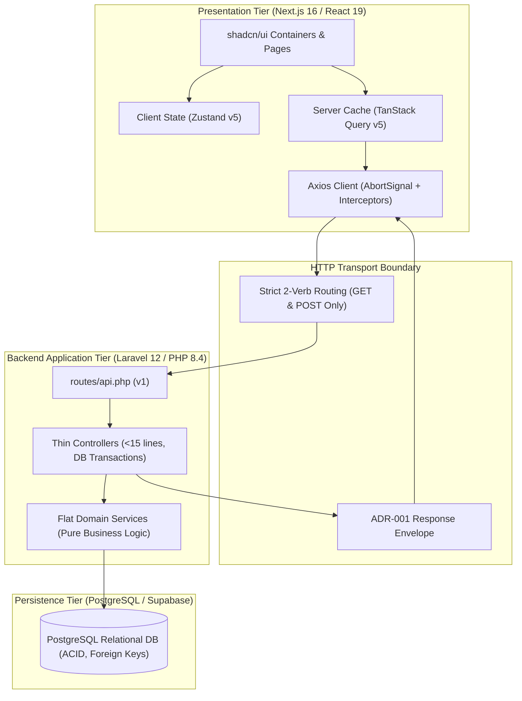
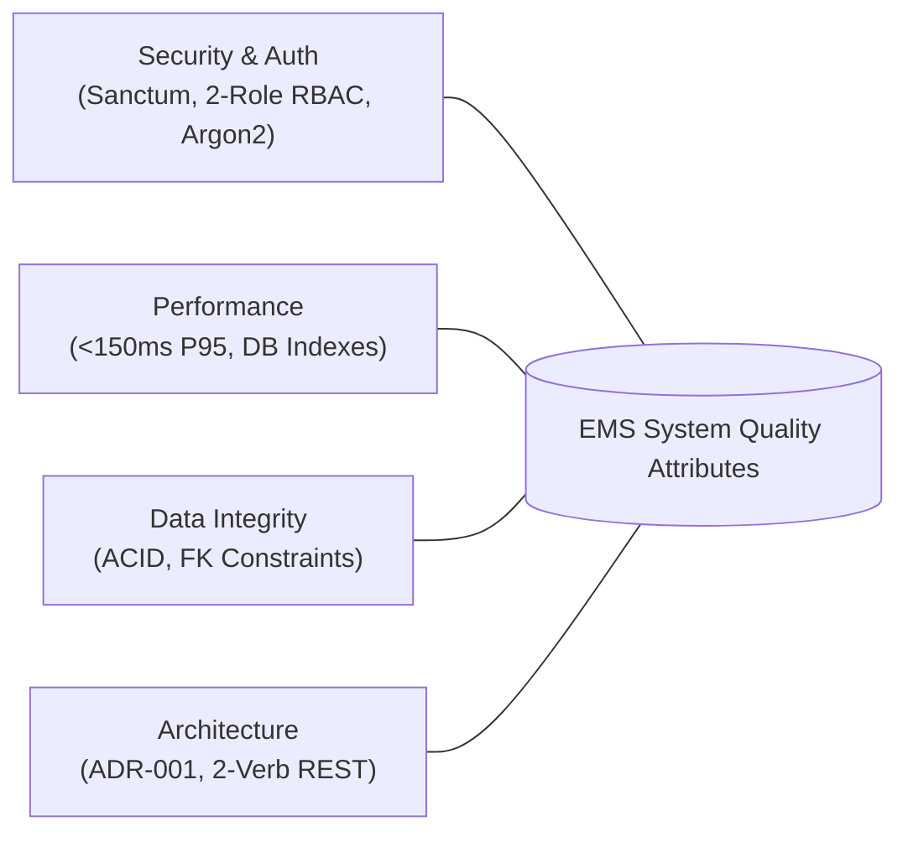
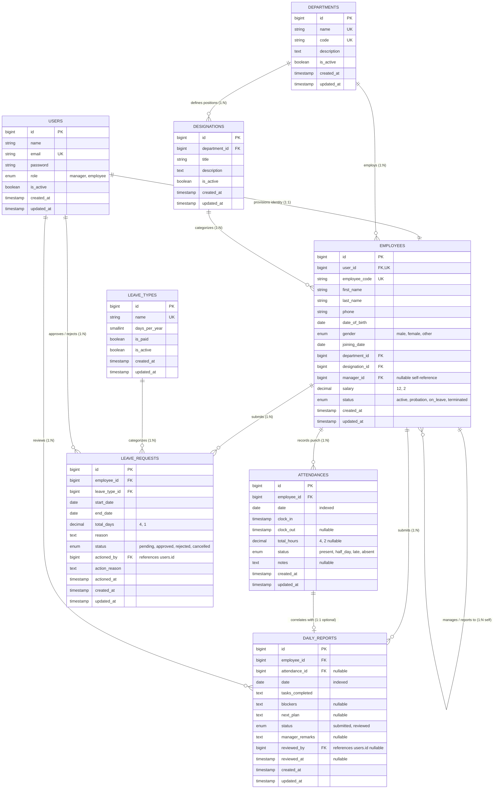
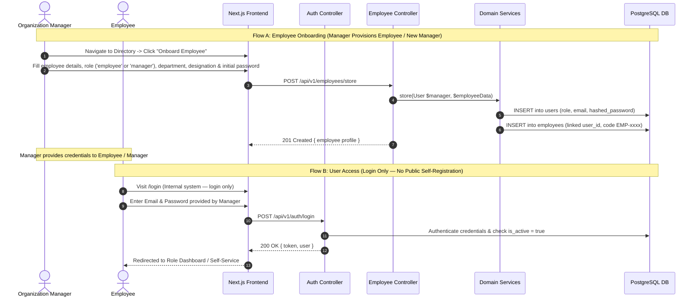
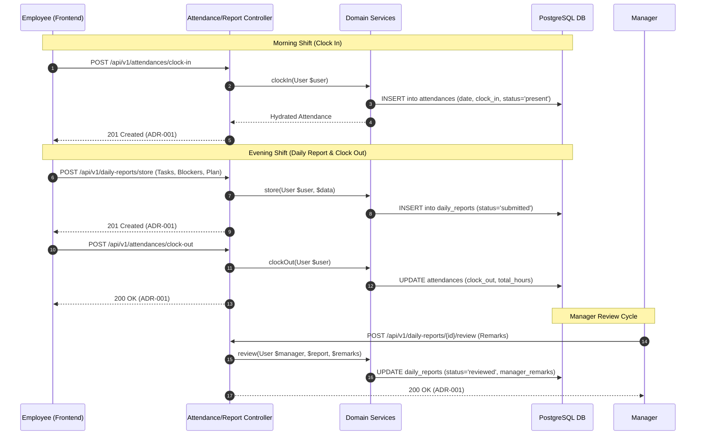

# Project Requirements: Employee Management System (EMS)

> **Document Version:** 2.3.0  
> **Classification:** Core HRMS / Enterprise Operations  
> **Status:** Approved Baseline Specification (Includes Manager Self-Service Signup & Employee Onboarding Provisioning Model)  
> **Governing Standards:** [`AGENTS.md`](AGENTS.md), [`ARCHITECTURE.md`](ARCHITECTURE.md), and [`backend/laravel-engineering-handbook/GUIDELINES.md`](backend/laravel-engineering-handbook/GUIDELINES.md)

---

## 1. System Vision & Architecture

The **Employee Management System (EMS)** is an internal **Modular Core HRMS** designed with a streamlined **2-role operational model (`manager` and `employee`)**. It provides personnel administration, organizational hierarchy management, leave approval workflows, **daily attendance (clock in / clock out)**, and **daily work performance reporting** with strict relational integrity, thin controllers, and deterministic 2-verb REST APIs.



---

## 2. User Roles & Access Control Matrix (RBAC)

The system simplifies access into two clean, unambiguous roles:

| Role Code | Role Name | System Scope | Responsibilities & Capabilities |
| :--- | :--- | :--- | :--- |
| **`manager`** | Operational Manager / Lead | Administrative & Supervisory | **Internal Corporate ERP:** Initial manager account is provisioned via system seed. Full control over organizational structure, onboarding/managing employees (and other managers), leave policy configuration, leave approvals, attendance auditing, and reviewing daily work reports with feedback. |
| **`employee`** | Individual Contributor | Self-Scoped & Directory | **Login-Only Access (No Public Self-Registration):** Must be provisioned and onboarded exclusively by an organizational Manager via `POST /api/v1/employees/store`. Self-service profile viewing, company directory lookup, clock-in/out, submitting daily work reports, submitting leave requests, and cancelling own pending requests. |

### Feature Permission Matrix

| Feature Module | Specific Action | Manager | Employee |
| :--- | :--- | :---: | :---: |
| **Authentication** | Login / Logout / View Self Session | Yes | Yes |
| **Departments & Designations** | Create / Update / Delete | Yes | No |
| **Departments & Designations** | List / View Details | Yes | Yes |
| **Employee Directory** | List Directory / Search All Employees | Yes (Full) | No (Blocked - 403) |
| **Employee Profiles** | View Profile by ID | Yes (Any Profile) | Self Only (Own ID Only - 403 on others) |
| **Employee Profiles** | Create / Onboard New Profile | Yes | No |
| **Employee Profiles** | Edit Full Profile (Demographics + Job) | Yes | No |
| **Employee Profiles** | View Sensitive Fields (Salary/Pay) | Yes | Self Only |
| **Employee Lifecycle**| Transition Status (`active`, `probation`, `terminated`)| Yes | No |
| **Attendance (Clock In/Out)** | Clock In & Clock Out for Today | Yes | Yes |
| **Attendance Tracking** | View Daily / Monthly Attendance | All Employees | Self Only |
| **Daily Work Reports** | Submit / Update Today's Work Report | Yes | Yes (Own Only) |
| **Daily Work Reports** | View Daily Reports Feed | All Employees | Self Only |
| **Daily Work Reports** | Review & Add Feedback Remarks | Yes | No |
| **Leave Policies** | Configure Leave Types & Quotas | Yes | View Only |
| **Leave Requests** | Submit Leave Request | Yes | Yes |
| **Leave Requests** | View Requests | All Requests | Self Requests Only |
| **Leave Requests** | Approve / Reject Requests | Yes | No |
| **Leave Requests** | Cancel Pending Request | Yes (Own / Managed) | Self Only (Pending Only) |

---

## 3. Functional Requirements (FR)

### 3.1. Authentication & Identity Management

| Requirement ID | Name | Description | Inputs | Expected Output | Constraints & Rules |
| :--- | :--- | :--- | :--- | :--- | :--- |
| **FR-AUTH-01** | User Login | Authenticate user with credentials and issue Bearer token. | `email`, `password`, `device_name` | Bearer token, User profile, Role (`manager` or `employee`) | Both Managers and Employees authenticate here. Reject inactive accounts (`is_active = false`). Public self-registration is disabled (ERP architecture). |
| **FR-AUTH-02** | User Logout | Invalidate current user session token. | Auth Bearer Header | Success acknowledgment | Revoke active Sanctum token only. |
| **FR-AUTH-03** | Get Current User | Retrieve authenticated user profile with linked employee record. | Auth Bearer Header | User entity + Employee entity | Eager load department, designation, and reporting manager. |

### 3.2. Organizational Structure (Departments & Designations)

| Requirement ID | Name | Description | Inputs | Expected Output | Constraints & Rules |
| :--- | :--- | :--- | :--- | :--- | :--- |
| **FR-ORG-01** | Create Department | Provision a new organizational unit. | `name`, `code`, `description`, `is_active` | Created department entity | `name` and `code` must be unique. Restricted to `manager`. |
| **FR-ORG-02** | Update Department | Modify department details. | `id`, `name`, `code`, `description`, `is_active` | Updated department entity | Maintain unique constraints ignoring current ID. Restricted to `manager`. |
| **FR-ORG-03** | Delete Department | Remove department from system. | `id` | Success acknowledgment | **BLOCKED (`restrictOnDelete`)** if designations or employees are assigned. |
| **FR-ORG-04** | Create Designation | Define a job title linked to a department. | `department_id`, `title`, `description`, `is_active` | Created designation entity | `department_id` must exist and be active. Restricted to `manager`. |
| **FR-ORG-05** | Delete Designation | Remove designation from system. | `id` | Success acknowledgment | **BLOCKED (`restrictOnDelete`)** if active employees hold this designation. |

### 3.3. Employee Lifecycle Management

| Requirement ID | Name | Description | Inputs | Expected Output | Constraints & Rules |
| :--- | :--- | :--- | :--- | :--- | :--- |
| **FR-EMP-00** | View Employees & Profile | Browse employee directory or inspect profile details. | `id` (for show), query filters (for index) | Employee list or profile entity | **Directory listing (`index`) is strictly restricted to `manager` (403 for employees).** Single profile view (`show`) is open to `manager` for any ID, and `employee` for their **own ID only** (403 on others). |
| **FR-EMP-01** | Onboard Employee | Provision a new employee and generate linked user credentials. | `first_name`, `last_name`, `email`, `password`, `role`, `phone`, `joining_date`, `department_id`, `designation_id`, `manager_id`, `salary`, `status` | Created User & Employee entity | Must run inside atomic `DB::beginTransaction()`. Auto-generate `employee_code` (e.g. `EMP-0001`). Restricted to `manager`. |
| **FR-EMP-02** | Update Profile | Update job and demographic information. | `id`, employee fields | Updated employee entity | Restricted to `manager`. |
| **FR-EMP-03** | Status Transition | Transition employee lifecycle stage. | `id`, `status`, `reason` | Updated status acknowledgment | Valid transitions: `probation` $\rightarrow$ `active` $\rightarrow$ `terminated` or `on_leave`. Restricted to `manager`. |
| **FR-EMP-04** | Reporting Line Check | Validate supervisor hierarchy. | `manager_id`, `id` | Validation pass/fail | Hierarchy cycle prevented: an employee cannot manage themselves (`manager_id != id`). |

### 3.4. Attendance & Time Tracking (Clock In / Clock Out)

| Requirement ID | Name | Description | Inputs | Expected Output | Constraints & Rules |
| :--- | :--- | :--- | :--- | :--- | :--- |
| **FR-ATT-01** | Clock In | Record start of work shift for current date. | None (Auto system timestamp), optional `notes` | Created attendance record (`clock_in` set) | Only one record per employee per calendar date (`unique(employee_id, date)`). Cannot clock in twice on same day. |
| **FR-ATT-02** | Clock Out | Record end of work shift and calculate total hours. | None (Auto system timestamp), optional `notes` | Updated attendance record (`clock_out`, `total_hours` set) | Must have clocked in first. `total_hours` calculated automatically. |
| **FR-ATT-03** | Today Punch Status | Get current user's attendance status for today. | None | `{ is_clocked_in: bool, clock_in_at: datetime, clock_out_at: datetime, total_hours: float }` | Instant status for frontend navbar / punch widget. |
| **FR-ATT-04** | Attendance History | View paginated attendance logs. | Filters: `date`, `month`, `year`, `employee_id` | Paginated attendance list | Employee sees own attendance; Manager can view all or filter by department/employee. |

### 3.5. Daily Work Reports (Daily Standup & Performance Tracking)

| Requirement ID | Name | Description | Inputs | Expected Output | Constraints & Rules |
| :--- | :--- | :--- | :--- | :--- | :--- |
| **FR-REP-01** | Submit Daily Report | Submit end-of-day summary of tasks and blockers. | `tasks_completed`, `blockers`, `next_plan` | Created daily report entity (`status = submitted`) | Strictly 1 report per employee per date (`unique(employee_id, date)`). Auto-links to today's attendance record if present. |
| **FR-REP-02** | Update Daily Report | Revise today's submitted work report. | `tasks_completed`, `blockers`, `next_plan` | Updated daily report entity | Editable only on the same calendar day before manager review. |
| **FR-REP-03** | Manager Review | Direct manager reviews report and provides feedback remarks. | `id`, `manager_remarks` | Updated daily report (`status = reviewed`, `reviewed_by`, `reviewed_at`) | Restricted to `manager`. Only the employee's assigned direct manager can review (or any manager if unassigned). Manager cannot review their own report. |
| **FR-REP-04** | Feed & History | View work reports feed across teams. | Filters: `date`, `employee_id`, `status` | Paginated daily reports feed | Employee sees own reports; Manager sees all reports across departments. |

### 3.6. Leave Management & Approval State Machine

| Requirement ID | Name | Description | Inputs | Expected Output | Constraints & Rules |
| :--- | :--- | :--- | :--- | :--- | :--- |
| **FR-LVE-01** | Apply for Leave | Submit a new time-off request. | `leave_type_id`, `start_date`, `end_date`, `reason` | Created leave request (`status = pending`) | `start_date <= end_date`. Total days cannot exceed available quota for year. |
| **FR-LVE-02** | Approve Request | Approve pending leave request. | `id` | Updated leave request (`status = approved`) | Restricted to `manager`. Only the employee's assigned direct manager can approve (or any manager if unassigned). Cannot approve own leave request. |
| **FR-LVE-03** | Reject Request | Decline pending leave request. | `id`, `action_reason` | Updated leave request (`status = rejected`) | Restricted to `manager`. Only the employee's assigned direct manager can reject (or any manager if unassigned). Rejection reason is mandatory. Cannot reject own leave request. |
| **FR-LVE-04** | Cancel Request | Cancel a previously requested leave. | `id` | Updated leave request (`status = cancelled`) | Allowed only while status is `pending` by the owning employee. |

---

## 4. Non-Functional Requirements (NFR)



### 4.1. Security & Authorization (NFR-SEC)

| Requirement ID | Metric / Standard | Specification | Verification Method |
| :--- | :--- | :--- | :--- |
| **NFR-SEC-01** | Token Transport | Sanctum Bearer tokens over HTTPS; token expiration configurable in `sanctum.php`. | Automated API Test |
| **NFR-SEC-02** | Password Security | Bcrypt / Argon2id hashing with work factor $\ge 12$. Plaintext passwords never logged. | Auth Service Inspection |
| **NFR-SEC-03** | 2-Role Enforcement | Controller middleware & service authorization checks (`role === 'manager'`). Forbidden actions return HTTP 403. | Feature Test Suite |
| **NFR-SEC-04** | Rate Limiting | Maximum 60 requests/minute per authenticated user; 10 attempts/minute on `/api/v1/auth/login`. | API Middleware Verification |

### 4.2. Performance & Scalability (NFR-PERF)

| Requirement ID | Metric / Standard | Target Threshold | Implementation Rule |
| :--- | :--- | :--- | :--- |
| **NFR-PERF-01** | API Response Latency | P95 $< 150\text{ ms}$, P99 $< 300\text{ ms}$ | Indexes on `(employee_id, date)` on attendances and daily reports. |
| **NFR-PERF-02** | Query Efficiency | Zero N+1 queries on all listing endpoints. | Mandatory eager loading (`with(['employee.user', 'employee.department'])`). |
| **NFR-PERF-03** | Concurrency Safety | Race-free punch and leave transactions. | Apply `lockForUpdate()` during clock-out calculation and leave quota deduction. |

### 4.3. Data Integrity & Reliability (NFR-REL)

| Requirement ID | Standard | Specification | Enforcement Boundary |
| :--- | :--- | :--- | :--- |
| **NFR-REL-01** | Foreign Key Rigidity | Referential cascades prohibited on financial, attendance, and employee history records. | PostgreSQL Schema (`restrictOnDelete()`). |
| **NFR-REL-02** | Transaction Scope | Multi-mutation endpoints must wrap execution in explicit transactions. | Controller: `DB::beginTransaction()`, `commit()`, `rollBack()`. |
| **NFR-REL-03** | Data Schema Typing | All monetary values (`salary`) and work metrics (`total_hours`, `leave_days`) stored as exact decimals (`decimal(12, 2)` or `decimal(4, 2)`). | PostgreSQL Schema & Model casts. |

### 4.4. Architectural Invariants (NFR-ARCH)

| Requirement ID | Standard | Specification | Rule Reference |
| :--- | :--- | :--- | :--- |
| **NFR-ARCH-01** | 2-Verb Protocol | Only `GET` (fetch) and `POST` (mutation) methods permitted across HTTP boundary. | `ARCHITECTURE.md` ADR-001 |
| **NFR-ARCH-02** | ADR-001 Envelope | Unified JSON payload: `is_error`, `message`, `data`, `errors`. On error, `data` is strictly `null`. | Laravel `BaseController` |
| **NFR-ARCH-03** | Layer Decoupling | Thin Controllers ($< 15$ lines) $\rightarrow$ Flat Domain Services (`app/Services/`) $\rightarrow$ Eloquent Models. | Laravel Handbook Module 02 |

---

## 5. Entity-Relationship Data Model (ERD)



---

## 6. System Workflows & Operations

### 6.1. Account Provisioning Flow (Manager Signup vs. Employee Onboarding)



### 6.2. Daily Attendance & Reporting Flow



---

## 7. API Endpoints Catalog (Strict 2-Verb Routing)

All routes are mounted under `/api/v1/` and return the ADR-001 JSON schema.

| Feature Domain | Verb | URI Endpoint | Allowed Roles | Request Body Summary | Success Code |
| :--- | :---: | :--- | :--- | :--- | :---: |
| **Auth** | `POST` | `/api/v1/auth/login` | Public (Manager & Employee) | `email`, `password`, `device_name` | `200 OK` |
| **Auth** | `POST` | `/api/v1/auth/logout` | Authenticated | None (Bearer Header) | `200 OK` |
| **Auth** | `GET` | `/api/v1/auth/me` | Authenticated | None (Bearer Header) | `200 OK` |
| **Departments** | `GET` | `/api/v1/departments` | All | Query params: `page`, `search` | `200 OK` |
| **Departments** | `GET` | `/api/v1/departments/{id}` | All | Route param: `id` | `200 OK` |
| **Departments** | `POST` | `/api/v1/departments/store` | `manager` | `name`, `code`, `description`, `is_active` | `201 Created` |
| **Departments** | `POST` | `/api/v1/departments/{id}/update` | `manager` | `name`, `code`, `description`, `is_active` | `200 OK` |
| **Departments** | `POST` | `/api/v1/departments/{id}/destroy` | `manager` | Route param: `id` | `200 OK` |
| **Designations** | `GET` | `/api/v1/designations` | All | Query params: `department_id`, `search` | `200 OK` |
| **Designations** | `GET` | `/api/v1/designations/{id}` | All | Route param: `id` | `200 OK` |
| **Designations** | `POST` | `/api/v1/designations/store` | `manager` | `department_id`, `title`, `description` | `201 Created` |
| **Designations** | `POST` | `/api/v1/designations/{id}/update` | `manager` | `title`, `description`, `is_active` | `200 OK` |
| **Designations** | `POST` | `/api/v1/designations/{id}/destroy` | `manager` | Route param: `id` | `200 OK` |
| **Employees** | `GET` | `/api/v1/employees` | All | Filters: `department_id`, `status`, `search` | `200 OK` |
| **Employees** | `GET` | `/api/v1/employees/{id}` | All | Route param: `id` | `200 OK` |
| **Employees** | `POST` | `/api/v1/employees/store` | `manager` | User credentials + Demographics + Job fields | `201 Created` |
| **Employees** | `POST` | `/api/v1/employees/{id}/update` | `manager` | Demographics + Job fields | `200 OK` |
| **Employees** | `POST` | `/api/v1/employees/{id}/status` | `manager` | `status` (`active`, `probation`, `terminated`) | `200 OK` |
| **Employees** | `POST` | `/api/v1/employees/{id}/destroy` | `manager` | Route param: `id` | `200 OK` |
| **Attendance** | `GET` | `/api/v1/attendances` | All (Scoped) | Query params: `date`, `month`, `year`, `employee_id` | `200 OK` |
| **Attendance** | `GET` | `/api/v1/attendances/today` | All | None (returns punch status for today) | `200 OK` |
| **Attendance** | `POST` | `/api/v1/attendances/clock-in` | All | Optional `notes` | `201 Created` |
| **Attendance** | `POST` | `/api/v1/attendances/clock-out` | All | Optional `notes` | `200 OK` |
| **Daily Reports**| `GET` | `/api/v1/daily-reports` | All (Scoped) | Query params: `date`, `employee_id`, `status` | `200 OK` |
| **Daily Reports**| `GET` | `/api/v1/daily-reports/{id}` | All (Scoped) | Route param: `id` | `200 OK` |
| **Daily Reports**| `POST` | `/api/v1/daily-reports/store` | All | `tasks_completed`, `blockers`, `next_plan` | `201 Created` |
| **Daily Reports**| `POST` | `/api/v1/daily-reports/{id}/update` | Employee (Owner)| `tasks_completed`, `blockers`, `next_plan` | `200 OK` |
| **Daily Reports**| `POST` | `/api/v1/daily-reports/{id}/review` | `manager` | `manager_remarks` | `200 OK` |
| **Leave Policies**| `GET` | `/api/v1/leave-types` | All | None | `200 OK` |
| **Leave Policies**| `POST` | `/api/v1/leave-types/store` | `manager` | `name`, `days_per_year`, `is_paid` | `201 Created` |
| **Leave Policies**| `POST` | `/api/v1/leave-types/{id}/update`| `manager` | `name`, `days_per_year`, `is_paid` | `200 OK` |
| **Leave Policies**| `POST` | `/api/v1/leave-types/{id}/destroy`| `manager` | Route param: `id` | `200 OK` |
| **Leave Requests**| `GET` | `/api/v1/leave-requests` | All (Scoped) | Query params: `status` (Manager sees all; Employee sees own) | `200 OK` |
| **Leave Requests**| `GET` | `/api/v1/leave-requests/{id}` | All (Scoped) | Route param: `id` | `200 OK` |
| **Leave Requests**| `POST` | `/api/v1/leave-requests/store` | All | `leave_type_id`, `start_date`, `end_date`, `reason` | `201 Created` |
| **Leave Requests**| `POST` | `/api/v1/leave-requests/{id}/approve` | `manager` | None | `200 OK` |
| **Leave Requests**| `POST` | `/api/v1/leave-requests/{id}/reject` | `manager` | `action_reason` | `200 OK` |
| **Leave Requests**| `POST` | `/api/v1/leave-requests/{id}/cancel` | Employee (Owner)| None | `200 OK` |

---

## 8. ADR-001 Unified Response Envelope Specification

Every API endpoint strictly conforms to the ADR-001 schema:

### 8.1. Success Envelope (`200 OK` or `201 Created`)
```json
{
  "is_error": false,
  "message": "Resource processed successfully.",
  "data": {
    "id": 101,
    "employee_code": "EMP-00101",
    "first_name": "Arjun",
    "last_name": "Patel",
    "status": "active"
  }
}
```

### 8.2. Client/Server Error Envelope (`400`, `401`, `403`, `404`, `500`)
```json
{
  "is_error": true,
  "message": "You have already clocked in for today.",
  "data": null
}
```

### 8.3. Validation Error Envelope (`422 Unprocessable Content`)
```json
{
  "is_error": true,
  "message": "The given data was invalid.",
  "data": null,
  "errors": {
    "tasks_completed": ["The tasks completed field is required."]
  }
}
```
